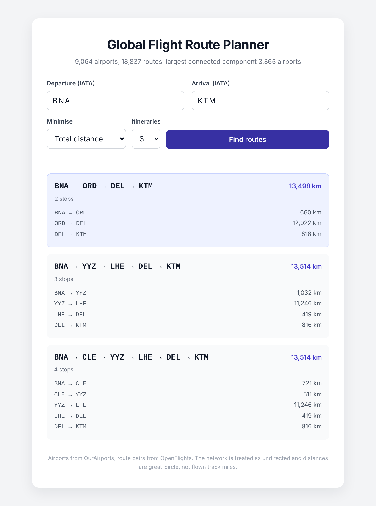

# Global Flight Route Planner

A small tool for asking routing questions about the world's scheduled airline
network: given two airports, what are the best ways to get between them, and
what does "best" cost you depending on how you define it?



The network is built from two public datasets: airport locations from
[OurAirports](https://ourairports.com/data/) and route pairs from
[OpenFlights](https://openflights.org/data.html). After keeping only airports
with an IATA code, it has **9,064 airports and 18,837 undirected routes**.

## Quickstart

```bash
pip install -r requirements.txt

# descriptive statistics about the network
python main.py --summary

# shortest itinerary by total distance
python main.py --from BNA --to KTM

# fewest segments instead, and show the three best options
python main.py --from BNA --to KTM --metric hops --k 3

# browser interface at http://127.0.0.1:8000
python main.py --serve
```

## Two definitions of "best"

The planner minimises one of two things, and they disagree more often than you
would expect. Nashville to Kathmandu, for example:

| Metric | Itinerary | Segments | Distance |
| --- | --- | --- | --- |
| `hops` | BNA → JFK → DEL → KTM | 3 | 13,801 km |
| `distance` | BNA → ORD → DEL → KTM | 3 | 13,498 km |

Same number of stops, 300 km apart. With more connected city pairs the gap
widens, and the fewest-segment itinerary can be well over a thousand kilometres
longer than the shortest one.

## What the data looks like

A few things worth knowing before trusting any result:

- **Most airports are not reachable.** Of the 9,064 airports with an IATA code,
  only **3,365 sit in the largest connected component**. The rest are isolated or
  sit in small regional clusters that the OpenFlights route table never links to
  the global network. Any routing question outside that component has no answer.
- **The degree distribution is very skewed.** Mean degree is 4.16, but the busiest
  airport has 246 distinct route partners. Hub structure dominates every path the
  planner returns.
- **1,283 route records are dropped** because one endpoint has no matching airport
  row, mostly defunct airports and non-IATA codes.

## Modelling simplifications

These are deliberate, and they bound what the tool can honestly be used for:

- Routes are recorded as directed pairs but the graph is **undirected**. Nearly all
  scheduled segments are flown both ways, and the questions here (reachability,
  segment count, distance) are symmetric. Anything schedule-dependent would need
  the directed graph.
- Distances are **great-circle**, not flown track miles, and ignore winds and
  airway structure.
- There is **no notion of time**: no schedules, no connection feasibility, no
  minimum connection times. A three-segment itinerary returned here may not be
  bookable as a single journey.
- The route table is a **snapshot**, not a live feed.

## Where this is going

The routing problem above is the scaffolding, not the point. What interests me is
the next question: airport capacity is scarce, and when it runs out somebody has
to decide which flights are delayed and which are not. That decision is a priority
ordering over people, and the schemes used in practice trade off efficiency
against how defensible the ordering is to the people subject to it.

The direction I want to take this:

1. Add real operational data (schedules and realised delays) on top of the network.
2. Formulate a capacity-constrained allocation as an integer program.
3. Ask whether the optimal allocation can be approximated by a **sparse, readable
   decision rule**, and measure what that readability costs.

Step 3 is the part I actually care about. Interpretable models such as sparse
decision trees and scoring systems are found by solving discrete optimization
problems, and the open question is how much performance you give up to get a rule
a person can read and contest.

## Layout

```
main.py              CLI entry point
src/data_loader.py   read and join the OurAirports reference tables
src/graph_builder.py one node per airport with an IATA code
src/route_loader.py  add OpenFlights route pairs as edges
src/path_finder.py   great-circle distance and k-shortest-path search
src/server.py        dependency-free web interface (stdlib http.server)
index.html           browser front end, no build step and no CDN
data/                the two public datasets, vendored for reproducibility
```

Requires Python 3.10 or newer. The only dependencies are pandas and networkx.
